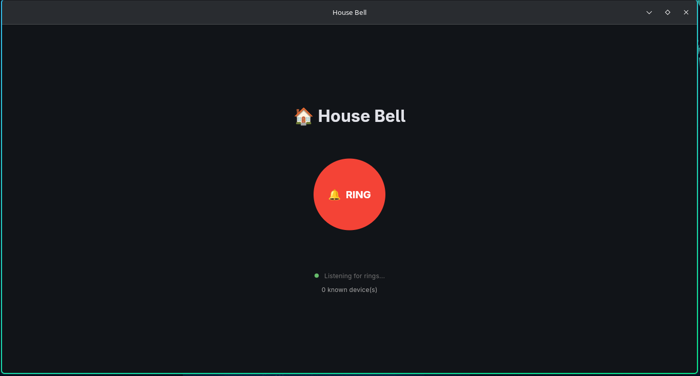

# 🏠 house_bell

A software doorbell for your local network. Run it on a few devices, and anyone can press the button to ring all the others. No server, no cloud, no hardware.

Built with Python and [Flet](https://flet.dev). Runs on desktop and Android.



## Features

- **Peer-to-peer:** every device is both a sender and a receiver, with no fixed "door" or "receiver" role
- **LAN only:** nothing leaves your network and no internet is required
- **Automatic discovery:** devices find each other using a lightweight gossip protocol over UDP
- **Reliable delivery:** a ring is broadcast first, then sent directly to any known device that didn't confirm
- **Alerts:** a dialog pops up and a bell sound plays on every other device
- **Network-friendly:** peers are identified by a session ID rather than an IP address, so a device that reconnects to WiFi and gets a new IP isn't treated as a new device

## Requirements

- Python 3.10 or newer (built and tested with 3.12)
- All devices on the same local network
- Dependencies are listed in `requirements.txt` (Flet and flet-audio)

## Installation

```bash
git clone https://github.com/kevin-297/house_bell.git
cd house_bell
python -m venv venv
source venv/bin/activate        # on Windows: venv\Scripts\activate
pip install -r requirements.txt
```

## Usage

Run the app on every device that should hear the bell:

```bash
python main.py
```

Press **RING** on any device and all the others will alert. The screen shows how many other devices have been discovered.

## Android

An APK is built automatically by GitHub Actions on every push to `main`.

**Download a build:**
1. Open the [Actions tab](https://github.com/kevin-297/house_bell/actions)
2. Click the latest successful **Build Android APK** run
3. Download `house-bell-apk` from the **Artifacts** section and unzip it
4. Install the `.apk` on your phone (you may need to allow installs from unknown sources)

**Build it yourself:**
```bash
pip install flet flet-cli flet-audio
flet build apk --android-permissions android.permission.INTERNET=true \
  android.permission.ACCESS_WIFI_STATE=true \
  android.permission.ACCESS_NETWORK_STATE=true
```
The APK ends up in `build/apk/`. You'll need the Flutter SDK and JDK 17 installed. CI uses Flutter 3.44.8, which is the version it was tested with.

## Configuration

The settings are constants at the top of `main.py`:

| Setting | Default | Description |
|---|---|---|
| `PORT` | `50000` | UDP port used for all communication |
| `BROADCAST_ADDR` | `255.255.255.255` | If your router blocks this, use your subnet's broadcast address, e.g. `192.168.1.255` |
| `ANNOUNCE_INTERVAL` | `20` | Seconds between presence broadcasts |
| `LIVENESS_INTERVAL` | `15` | Seconds between liveness checks of known peers |

The bell sound is `assets/bell.mp3`. Replace it with your own file to change it.

## Troubleshooting

- **Devices don't find each other:** check that they're on the same network and that your firewall allows **UDP port 50000**. Some routers also isolate WiFi clients from each other ("AP isolation"), which blocks this kind of traffic.
- **Rings don't arrive via broadcast:** set `BROADCAST_ADDR` to your subnet's broadcast address. Known devices still get direct delivery as a fallback.
- **No sound:** make sure the audio file exists in `assets/`.
- **Android:** the phone must be on the same WiFi as the other devices.

## How it works

All messages are JSON over UDP on a single port:

| Message | Type | Purpose |
|---|---|---|
| `ANNOUNCE` | broadcast, periodic | "I exist, and here's who I know" |
| `ANNOUNCE_REPLY` | unicast | Only the peers the other side didn't know about |
| `PING` / `ACK` | unicast, periodic | Liveness check; peers that miss several rounds are dropped |
| `RING` | broadcast, then unicast | The doorbell event |
| `RING_ACK` | unicast | "Got it, no need to resend" |

When you press the button, the ring is broadcast first because it's cheap and also reaches devices not yet discovered. After a short wait, the sender sends directly to any known peer that hasn't acknowledged. Duplicate rings are ignored, so you never get alerted twice for one press.

## Limitations

There is no authentication or encryption. Anyone on your local network who runs the app, or sends the right UDP messages, can ring your bell. It's meant for a trusted home network.

## License

AGPL-3.0, see [LICENSE](LICENSE).
